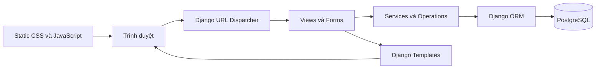

# NÂU COFFEE

### Hệ thống website thương mại điện tử dành cho cửa hàng đồ uống

| Thông tin | Nội dung |
|---|---|
| Trường | Trường Đại học Giao thông vận tải Thành phố Hồ Chí Minh (UTH) |
| Đơn vị | Viện Đào tạo Chất lượng cao |
| Học phần | Thương mại điện tử |
| Giảng viên hướng dẫn | Nguyễn Ngọc Thạch |
| Nhóm thực hiện | Nhóm 5 |
| Năm thực hiện | 2026 |

## 1. Giới thiệu dự án

Nâu Coffee là hệ thống thương mại điện tử B2C dành cho cửa hàng đồ uống. Hệ thống kết hợp hoạt động bán hàng tại quầy với website đặt trước, thanh toán mô phỏng và nhận món tại quán.

Dự án cung cấp một quy trình xuyên suốt từ quản lý thực đơn, cấu hình sản phẩm, giỏ hàng, đặt món và thanh toán đến tiếp nhận đơn, pha chế, kiểm soát kho và quản trị vận hành. Các chức năng được phân quyền theo bốn vai trò: Guest, Customer, Staff và Admin.

## 2. Mục tiêu hệ thống

- Số hóa quy trình bán đồ uống trên website và tại quầy.
- Quản lý tập trung sản phẩm, SKU, giá theo kênh và trạng thái kinh doanh.
- Hỗ trợ khách hàng tìm món, tạo tài khoản, đặt trước và theo dõi đơn.
- Hỗ trợ nhân viên tiếp nhận đơn, bán hàng tại quầy và vận hành hàng chờ pha chế.
- Quản lý thanh toán mô phỏng, voucher, kho nguyên liệu, công thức BOM và lịch sử trạng thái.
- Cung cấp công cụ quản trị, báo cáo và cấu hình phục vụ vận hành.
- Lưu trữ dữ liệu có cấu trúc trong PostgreSQL thông qua Django ORM.

## 3. Công nghệ sử dụng

### Công nghệ chạy ứng dụng

| Thành phần | Công nghệ | Vai trò |
|---|---|---|
| Backend | Python, Django | Xử lý request, nghiệp vụ, phân quyền và quản trị |
| Giao diện | Django Templates, HTML, CSS, JavaScript | Render giao diện và tương tác phía trình duyệt |
| Cơ sở dữ liệu | PostgreSQL 17 | Lưu dữ liệu nghiệp vụ |
| Truy cập dữ liệu | Django ORM | Ánh xạ model, truy vấn và quản lý migration |
| Static production | WhiteNoise | Phục vụ static assets trong cấu hình triển khai |
| WSGI production | Gunicorn | Chạy ứng dụng trong môi trường triển khai |

### Công cụ phát triển

| Công cụ | Mục đích |
|---|---|
| WSL2 Ubuntu | Môi trường phát triển Linux trên Windows |
| Visual Studio Code | Biên tập, chạy và kiểm tra source |
| Git, GitHub | Quản lý phiên bản và cộng tác |
| Docker | Cô lập các dịch vụ phát triển và kiểm thử khi cần |
| pgAdmin 4 | Quan sát và quản trị PostgreSQL bằng giao diện |
| Chromium/Playwright | Kiểm thử giao diện và responsive |

## 4. Chức năng chính

### Guest

- Xem trang chủ, thực đơn và chi tiết sản phẩm.
- Tìm kiếm thức uống theo tên có dấu hoặc không dấu.
- Lọc, sắp xếp thực đơn và thêm món vào giỏ tạm.
- Đăng ký hoặc đăng nhập khi cần hoàn tất đặt hàng.

### Customer

- Đăng ký tài khoản với họ tên, số điện thoại, email và tên đăng nhập.
- Xác minh email, đăng nhập và khôi phục mật khẩu.
- Quản lý hồ sơ, địa chỉ, quyền riêng tư và lịch sử đơn.
- Cấu hình món, quản lý giỏ hàng, chọn voucher hợp lệ và checkout.
- Chọn lịch nhận món theo quy tắc vận hành hoặc dùng giờ nhận tự động.
- Mô phỏng thanh toán thành công hoặc thất bại.
- Theo dõi đơn hàng, hủy đơn khi đủ điều kiện và gửi đánh giá.

### Staff

- Đăng nhập qua cổng nội bộ.
- Tạo đơn COUNTER tại quầy bằng POS.
- Nhận diện khách hàng theo quy trình xác minh được phân quyền.
- Tiếp nhận và quản lý đơn trong Kanban pha chế.
- Cập nhật trạng thái, trừ nguyên liệu khi bắt đầu pha và hoàn tất bàn giao.
- Theo dõi tồn kho và các nghiệp vụ vận hành được cấp quyền.

### Admin

- Quản lý danh mục, sản phẩm, SKU và giá bán theo kênh.
- Quản lý đơn hàng, thanh toán, hoàn tiền mô phỏng và tài khoản.
- Quản lý nguyên liệu, BOM, biến động kho và báo cáo.
- Quản lý voucher công khai, voucher riêng và dữ liệu voucher cũ.
- Quản lý chính sách, consent, đánh giá, phản hồi và cấu hình hệ thống.
- Sử dụng Django Admin và dashboard quản trị theo phân quyền.

### Phạm vi kênh bán hàng

| Kênh | Phạm vi |
|---|---|
| WEB | Chỉ đặt trước và nhận tại quán (Pickup Only) |
| COUNTER | Bán trực tiếp tại quầy qua Staff POS |
| APP | Kênh giá riêng để quản lý/đối chiếu; chưa khẳng định tích hợp API ShopeeFood hoặc nền tảng giao món |

Thanh toán trên website sử dụng phương thức **MOCK_ONLINE**, không thu tiền thật. Trang thanh toán cho phép chủ động mô phỏng hai kết quả **thành công** và **thất bại** để trình diễn đầy đủ vòng đời giao dịch.

## 5. Kiến trúc hệ thống

Ứng dụng sử dụng kiến trúc Django nhiều lớp. View tiếp nhận request và điều phối luồng; lớp service/operation thực hiện nghiệp vụ; Django ORM quản lý truy vấn và tính toàn vẹn dữ liệu trong PostgreSQL.



Các kiểm tra quan trọng như phân quyền, quyền sở hữu đơn, giá bán, voucher, lịch nhận món, trạng thái thanh toán và tồn kho đều được xác minh ở backend; giao diện không phải lớp bảo vệ duy nhất.

## 6. Cấu trúc thư mục

```text
NauCoffee/
├── manage.py                  # Điểm vào lệnh quản trị Django
├── config/                    # Settings, URL gốc, middleware và safety guards
├── catalog/                   # Sản phẩm, tài khoản, dashboard, kho và quản trị
├── commerce/                  # Giỏ hàng, checkout, đơn hàng, thanh toán và voucher
├── support/                   # Chính sách, đánh giá, phản hồi và consent
├── templates/                 # Django Templates dùng chung và theo chức năng
├── static/                    # CSS, JavaScript, font và hình ảnh tĩnh
├── scripts/                   # Launcher, kiểm tra môi trường và tác vụ hỗ trợ
├── tests/                     # Kiểm thử backend và integration
├── browser_tests/             # Kiểm thử giao diện bằng trình duyệt
├── docs/                      # Đặc tả, ERD, quyết định và báo cáo QA
├── requirements.txt           # Khoảng phiên bản dependency
└── requirements.lock          # Dependency đã khóa cho môi trường tái lập
```

## 7. Chạy trên máy local đã cấu hình

Trên môi trường WSL2 đã được cấu hình cho dự án, chạy:

```bash
cd /home/thientran/projects/NauCoffee
.venv/bin/python scripts/local_feature_preview.py inspect
.venv/bin/python scripts/local_feature_preview.py serve
```

Truy cập:

```text
http://127.0.0.1:8000/
```

Lệnh `inspect` kiểm tra danh tính môi trường, database và điều kiện an toàn trước khi phục vụ. Đây là quy trình dành cho máy phát triển hiện tại, không phải quy trình cài đặt hoàn toàn mới và không nên sao chép thông tin xác thực giữa các máy.

## 8. Cài đặt trên máy mới

### 8.1. Yêu cầu

- Git.
- Python 3 và module `venv`.
- PostgreSQL 17.
- Trình biên dịch/các thư viện hệ thống cần thiết cho dependency Python.
- WSL2 Ubuntu được khuyến nghị nếu phát triển trên Windows.

### 8.2. Giải nén source và tạo môi trường Python

```bash
unzip Thuong_mai_dien_tu_Nau_Coffee.zip
cd Thuong_mai_dien_tu_Nau_Coffee
python3 -m venv .venv
.venv/bin/python -m pip install --upgrade pip
.venv/bin/python -m pip install -r requirements.lock
```

Bản source nộp được cung cấp dưới dạng ZIP nên không phụ thuộc repository cũ. Repository mới dự kiến tại `https://github.com/dauiudau11-cpu/Thuong_mai_dien_tu_Nau_Coffee` nhưng chưa được tạo ở thời điểm đóng gói. Không lưu token trong source hoặc trong lệnh được chia sẻ.

### 8.3. Cấu hình môi trường

```bash
cp .env.example .env
```

Sau đó cấu hình các giá trị local phù hợp, tối thiểu gồm:

- `DJANGO_SECRET_KEY`: khóa riêng của môi trường.
- `DATABASE_URL`: kết nối đến database PostgreSQL dành riêng cho máy mới.
- Các host/CSRF origin và feature flag đúng mục đích sử dụng.
- Email backend sandbox trong môi trường phát triển.

Không dùng giá trị mẫu làm secret thật, không commit `.env`, không dùng database preview/production của người khác và không giả định database mới đã có dữ liệu.

### 8.4. Khởi tạo schema trên database mới, rỗng

```bash
.venv/bin/python manage.py check
.venv/bin/python manage.py migrate
.venv/bin/python manage.py runserver 127.0.0.1:8000
```

Chỉ chạy migration sau khi đã xác minh đúng database đích. Dữ liệu demo, tài khoản demo hoặc bootstrap chỉ được tạo trên database mới và tách biệt theo tài liệu vận hành tương ứng; không chạy seed trên database đang có dữ liệu.

## 9. Các đường dẫn chức năng

| Chức năng | Đường dẫn |
|---|---|
| Trang chủ | `/` |
| Thực đơn | `/menu/` |
| Đăng ký Customer | `/accounts/register/` |
| Đăng nhập Customer | `/accounts/login/` |
| Checkout | `/checkout/` |
| Dashboard nội bộ | `/dashboard/` |
| Đăng nhập Staff/Admin | `/internal/login/` |
| Django Admin | `/admin/` |

Một số đường dẫn yêu cầu đăng nhập, đúng vai trò hoặc dữ liệu phiên hợp lệ. Checkout bắt buộc Customer đăng nhập và có giỏ hàng hợp lệ.

## 10. Hướng dẫn đọc source code

| Chức năng | File liên quan | Nội dung chính |
|---|---|---|
| Tìm kiếm sản phẩm | `catalog/views.py`, `templates/catalog/menu.html`, `static/catalog/menu-filters.js` | Chuẩn hóa từ khóa tiếng Việt, lọc catalog WEB và cập nhật kết quả bằng GET/AJAX |
| Đăng ký và xác minh email | `catalog/customer_views.py`, `catalog/customer_accounts.py`, `catalog/customer_auth.py` | Tạo tài khoản, chuẩn hóa dữ liệu, activation token và giới hạn gửi lại email |
| Giỏ hàng | `commerce/views.py`, `commerce/models.py`, `templates/commerce/cart.html` | Giỏ guest/customer, dòng sản phẩm, số lượng và lựa chọn món |
| Checkout | `commerce/views.py`, `commerce/forms.py`, `templates/commerce/checkout.html` | Xác thực Customer, voucher, lịch nhận, tổng tiền và tạo đơn chờ thanh toán |
| Thanh toán mô phỏng | `commerce/views.py`, `commerce/services.py`, `templates/commerce/payment.html` | Hai kết quả success/failure, chống xử lý lặp, Payment và PaymentEvent |
| Quản lý đơn | `commerce/models.py`, `commerce/services.py`, `commerce/operations.py`, `templates/commerce/queue.html` | Vòng đời đơn, lịch sử trạng thái, hàng chờ và nghiệp vụ pha chế |
| Phân quyền | `catalog/permissions.py`, `catalog/customer_auth.py`, `config/middleware.py` | Kiểm tra role, cổng đăng nhập và quyền truy cập |
| Quản trị | `catalog/admin.py`, `commerce/admin.py`, `support/admin.py`, `templates/admin/` | Django Admin, form quản trị, sidebar và giao diện thống nhất |
| Lưu trữ PostgreSQL | `config/settings.py`, `catalog/models.py`, `commerce/models.py`, `support/models.py` | Cấu hình kết nối, model ORM, constraints và migration |

Các domain rule đầy đủ được mô tả trong `docs/NAU_COFFEE_V3_MASTER_SPEC.md`; mô hình dữ liệu được trình bày tại `docs/ERD.md`.

## 11. Cơ sở dữ liệu PostgreSQL

PostgreSQL lưu trữ sản phẩm, SKU, giá theo kênh, tài khoản, giỏ hàng, đơn hàng, thanh toán, lịch sử trạng thái, voucher, chính sách, công thức BOM, nguyên liệu, biến động kho và các dữ liệu vận hành khác. Ứng dụng truy cập dữ liệu thông qua Django ORM và migrations.

### Xác định database hiện hành an toàn

Không mặc định tên database là `nau_coffee_dev` hoặc `nau_coffee_test`. Sau khi nạp đúng cấu hình môi trường, có thể xem danh tính kết nối mà không in mật khẩu:

```bash
.venv/bin/python manage.py shell -c "from django.db import connection; c=connection.settings_dict; print({'HOST': c['HOST'], 'PORT': c['PORT'], 'NAME': c['NAME'], 'USER': c['USER']})"
```

Không chụp hoặc chia sẻ output nếu thông tin định danh môi trường thuộc phạm vi bảo mật.

### Xem dữ liệu bằng pgAdmin 4

1. Mở pgAdmin 4 và đăng ký một server mới.
2. Nhập host, port, database và role đã được cấp cho đúng môi trường.
3. Không lưu hoặc chia sẻ mật khẩu nếu không được phép.
4. Mở `Databases → <database hiện hành> → Schemas → public → Tables`.
5. Dùng **View/Edit Data** hoặc Query Tool cho truy vấn đọc khi trình diễn.
6. Không sửa trực tiếp bảng nghiệp vụ, không chạy migration/seed và không kết nối nhầm database đang phục vụ hệ thống khác.

## 12. Kiểm thử hệ thống

Kết quả dưới đây thuộc các lượt QA đã được xác nhận riêng biệt:

| Hạng mục | Kết quả |
|---|---|
| Django system check | PASS |
| Migration drift | PASS tại đợt QA cuối |
| Targeted regression gần nhất | 34/34 PASS |
| Tìm kiếm thực đơn trên Chromium | PASS tại 375px, 768px và 1440px |
| Hai lựa chọn thanh toán mô phỏng | 19/19 targeted tests PASS |
| Full regression sau toàn bộ thay đổi mới nhất | CHƯA CHẠY LẠI |

Các kết quả không được cộng gộp thành một tỷ lệ PASS toàn hệ thống. Khi thay đổi source, cần chạy lại phạm vi kiểm thử tương ứng trên database QA cách ly; không dùng database preview hoặc production cho test có thao tác ghi.

## 13. Hướng dẫn trình diễn

1. Mở trang chủ và giới thiệu mô hình WEB Pickup Only.
2. Mở thực đơn, tìm một thức uống bằng từ khóa có dấu và không dấu.
3. Đăng ký Customer, quan sát bước xác minh email rồi đăng nhập.
4. Chọn cấu hình món và thêm sản phẩm vào giỏ hàng.
5. Mở checkout, kiểm tra thông tin nhận món, lịch nhận và voucher.
6. Tạo đơn rồi trình diễn lần lượt kết quả thanh toán mô phỏng thành công hoặc thất bại bằng dữ liệu phù hợp.
7. Đăng nhập cổng nội bộ để minh họa Staff POS, Kanban và quản lý đơn.
8. Mở khu vực Admin để minh họa quản trị sản phẩm, giá, voucher, kho và chính sách.
9. Mở pgAdmin ở chế độ đọc để minh họa dữ liệu được lưu trong PostgreSQL.

Trong môi trường preview, email kích hoạt hoặc đặt lại mật khẩu có thể được chuyển vào hộp thư sandbox local. Không dùng Gmail thật nếu chưa có phê duyệt và cấu hình riêng.

## 14. Giới hạn và định hướng phát triển

- MOCK_ONLINE chỉ mô phỏng kết quả giao dịch, không kết nối cổng thanh toán và không thu tiền thật.
- Website chỉ nhận đơn Pickup; giao tận nơi được giới thiệu qua liên kết đối tác, chưa tự động tạo vận đơn.
- Chưa tích hợp API thời gian thực với GrabFood, ShopeeFood hoặc beFood.
- Email thật, HTTPS công khai và các dịch vụ cloud cần cấu hình riêng cho từng môi trường.
- Dữ liệu, tài khoản và chính sách trong đồ án mang tính demo; không đại diện cho hoạt động kinh doanh hoặc quan hệ đối tác thương mại thật.
- Trước khi vận hành thực tế cần bổ sung giám sát, backup/restore định kỳ, quản lý secrets, kiểm thử tải và tích hợp thanh toán/giao nhận được cấp phép.
