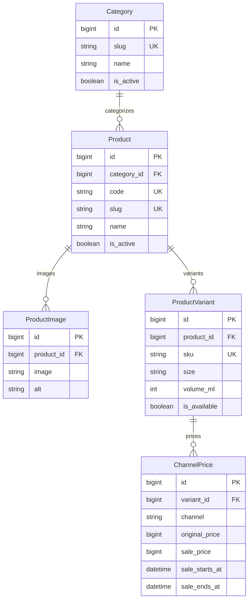
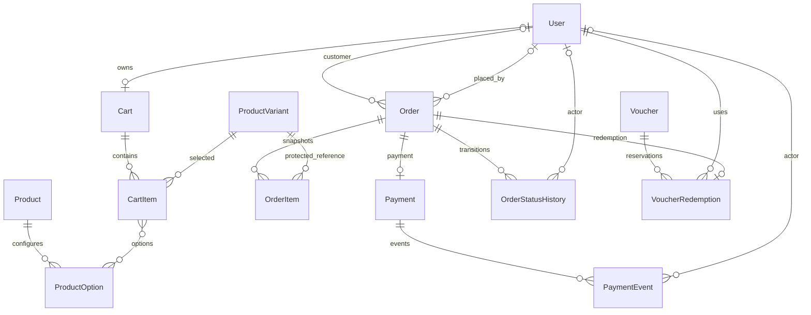
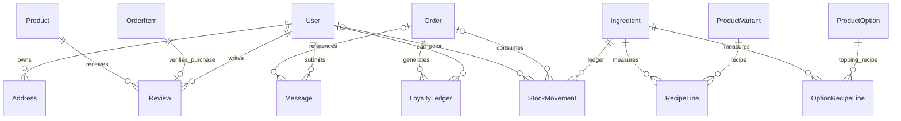

# ERD đã triển khai — Sprint 1

Nguồn: `catalog/models.py`, `commerce/models.py` và migrations catalog 0001/0002, commerce 0001. Migrations đã áp dụng trên PostgreSQL dev/test riêng; chỉ mô tả schema có thật.

Constraints: unique `(product, size)`, `(variant, channel)`; sale nhỏ hơn original với thời hạn bắt buộc/đúng thứ tự. Category và variant→product dùng PROTECT. Django auth User/Group/Permission dùng schema chuẩn Django, đăng ký gán CUSTOMER; group STAFF/ADMIN không được nhận từ client.

## Commerce schema đã triển khai

Cart owner XOR user/session UUID; unique cart+variant+configuration; qty 1–99. Order unique user+idempotency UUID và public UUID; WEB yêu cầu user; discount≤subtotal; total=subtotal-discount+shipping. OrderItem line_total=unit_price×qty, giữ name/SKU/options JSON snapshot và PROTECT variant/order. Payment OneToOne order; event unique payment+event_key. Voucher code unique Lower(code), dates/percent/usage bounds; redemption OneToOne order. StoreSettings là cấu hình độc lập DEMO về shipping. Schema mới của phiên cloud bổ sung Address, support/reviews/policies, BOM/stock và loyalty ở phần dưới. Delivery hiện dùng Order + OrderStatusHistory, chưa tách Delivery entity/GPS adapter.

## Schema cloud bổ sung — 18/10/2026

Nguồn: catalog migration 0003, commerce 0002, support 0001/0002; đã áp dụng PostgreSQL dev/test riêng.

Review rating DB 1–5, OneToOne order item; service vérifies owner + COMPLETED + matching product; Admin-only moderation, read-only source fields. Message có status/reply, order nullable với ownership check tại form. Policy slug unique; SubmissionLimit key unique theo scope + hashed identity + cửa sổ 10 phút, khóa row để dùng nhiều worker.

Order thêm scheduled_for, external_reference, delivery_distance_km và verified flag. Unique manual `(placed_by,idempotency_key)` khi channel != WEB; unique `(channel,external_reference)` khi reference không trống. Delivery verification 0–3 km được kiểm tra service và lưu actor/reason vào history. Lịch có store-row lock để giữ capacity khi tạo order.

Ingredient tồn được tính từ SUM StockMovement.delta, không có balance field có thể sửa ngoài ledger. Recipe quantity >0, unique variant/ingredient; topping unique option/ingredient. Movement key unique, delta !=0, ingredient rows khóa theo ID trước khi kiểm tra/trừ kho trong cùng transaction đổi trạng thái. Không sửa/xóa movement qua Admin. Thiếu kho rollback tất cả; view ghi lại thao tác bị từ chối vào order history.

LoyaltyLedger unique `(order,event)`, cộng qua service sau COMPLETED + PAID, không có endpoint sửa điểm tùy ý. StoreSettings có kiểm tra hours/lead/horizon/capacity/rate dương. Không có số dư loyalty cache cần đồng bộ.

## OrderItem recipe snapshot — 21/10/2026

Migration commerce0003 thêm `recipe_snapshot JSON nullable`. Mỗi dòng lưu list ingredient_id/name/unit/quantity-per-drink (Decimal string). WEB/manual checkout aggregate và check supply; PREPARING dùng snapshot, kiểm tra ingredient còn tồn tại/active/unit/supply, ghi StockMovement một lần. NULL chỉ đơn legacy, được chốt ở PREPARING thành công kèm audit; không backfill công thức checkout không tồn tại. Không thêm reservation model ở milestone này.
